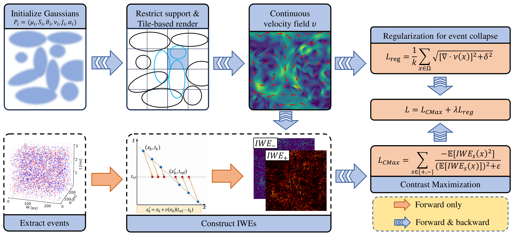

# AffineGS: Velocity Representation via Mixture of Affine Gaussians for Event-based Imaging Velocimetry

This repository contains the official code for the submitted paper __AffineGS: Velocity Representation via Mixture of Affine Gaussians for Event-based Imaging Velocimetry__. This paper presents an efficient method for event-based imaging velocimetry based on affine Gaussian (AffineGS) to reconstruct velocity fields from sparse event streams.


## Methods
[](data/fig2_method_overview.pdf)
The velocity field is modeled as a compact weighted superposition of localized anisotropic Gaussian primitives with continuous spatial support. Beyond a local velocity vector, each primitive is equipped with a velocity-gradient Jacobian matrix, which explicitly represents affine velocity variations within its neighborhood and improves the capacity to capture complex flow structures. The Gaussian parameters are estimated through test-time optimization in a contrast-maximization framework, where collapse-suppression regularization is incorporated to improve physical consistency. An adaptive density control strategy further refines the primitive distribution, while localized Gaussian evaluation and tile-based rendering reduce the computational cost.


## Install dependencies

From the repository root, create the reference Linux environment:

```bash
conda env create -f environment.yml
conda activate affinegs
python -m ipykernel install --user --name affinegs --display-name "AffineGS"
```

- [environment.yml](environment.yml) is the Conda setup entry point. It creates the Python environment, installs Ninja, and loads the Python packages below.
- [requirements.txt](requirements.txt) lists the pinned Python dependencies, including `ipywidgets` for notebook progress bars.
- [docs/reference-environment.json](docs/reference-environment.json) records the hardware, package versions and compilers used for the existing runs; it is not an installation file or a clean-install verification report.

The recorded setup uses Linux, Python 3.8.5, PyTorch 1.13.1+cu117 and an RTX 3090. The CUDA extensions were built with CUDA toolkit 11.2 and GCC 9.4.0; the PyTorch CUDA runtime is 11.7. A compatible NVIDIA driver, CUDA toolkit, C++ compiler and the Ninja executable are required for CUDA extension compilation. These external build tools are not installed by `requirements.txt`. The Jupyter or VS Code frontend may run separately; select the **AffineGS** kernel. EXP_OTHER requires an NVIDIA CUDA GPU.

The Gaussian renderer is compiled through PyTorch JIT when CUDA training is initialized, so the CUDA toolkit, compiler and `ninja` must remain available. Build the CMax extension for fused IWE accumulation:

``` bash
cd methods/affinegs/accelerators/cmax_fused
python setup.py build_ext --inplace
cd ../../../../
```

The Gaussian renderer is initialized before training. By default, import or JIT
compilation failure raises an explicit error (`cuda_renderer_policy="error"`),
so an efficiency run cannot silently switch backends. To permit the existing
PyTorch renderer explicitly, use `GaussianFlowConfig(cuda_renderer_policy="fallback")`.
This emits a warning on initialization failure; the selected backend is recorded
as `result.model.render_backend` (`"cuda"` or `"torch"`). CPU execution uses the
PyTorch renderer. Errors during kernel execution are propagated rather than
triggering a mid-training fallback. CMax uses its existing PyTorch path if its
prebuilt extension cannot be imported. Record both backends when reporting speed.

After changing CMax CUDA sources, rerun its build command above and restart the
notebook kernel to load the rebuilt binary. CUDA/JIT initialization should be
warmed up outside benchmark timing.

## The experiments
* [EXP1.ipynb](experiments/EXP1.ipynb): representation ablations, robustness and regularization sweeps, including paired sweeps with shared events and initialization.
* [EXP2.ipynb](experiments/EXP2.ipynb): six-method comparison on three bundled synthetic flow fields, using velocity and gradient metrics.
* [EXP3.ipynb](experiments/EXP3.ipynb): real-data flow estimation and visualization; saves velocity fields for appendix evaluation.
* [EXP_APPENDIX.ipynb](experiments/EXP_APPENDIX.ipynb): density-control ablation and FWL/RSAT evaluation using saved EXP3 velocity fields.
* [EXP_OTHER.ipynb](experiments/EXP_OTHER.ipynb): runtime, training-memory and Gaussian-count experiments.


## Saved experiment outputs

All five experiment notebooks contain inline figures or tables for browsing on GitHub. The paper's saved figures, metrics and velocity arrays are included directly under `output/`; local history and diagnostics remain ignored. EXP2 displays the saved results used in manuscript_revised_v2.

Results are grouped under `EXP1/`, `EXP2/`, `EXP3/`, `EXP_OTHER/` and `APPENDIX/`. EXP3 uses `ebiv/` and `water/` with method-named figures and arrays. All appendix results share `APPENDIX/`. FWL and RSAT export CSV files. The existing EXP_OTHER CSV files are saved snapshots at displayed precision; rerunning that notebook updates its displayed tables without exporting CSV. The saved `Table_03_Paper.csv` uses initial Gaussian counts for parameters, while the notebook reports final counts. GPU memory is the peak allocated memory from data upload through the end of optimization.

## Real-data result provenance

In EXP3, scene selection creates `output/EXP3/<scene>/`. Repeated runs use numbered suffixes such as `water-02/`. Keep the same directory selected while saving all six methods. Saved velocity arrays remain immutable, and figure and event hashes are recorded in `manifest.json`.

EXP_APPENDIX evaluates the saved EXP3 fields. Set `REAL_RUN_DIR` to select a specific scene directory; the default selects the newest numbered run and rejects incomplete results. FWL and RSAT export CSV files to `output/APPENDIX/`, with their flow and figure provenance retained in the scene manifest.

## Event input contract

Estimator events are tensors `[N, 4]` in `(row, column, time_ms, polarity)` order,
with finite values, coordinates inside the image and at least two distinct times.
GS checks its configuration before backend initialization; inactive density-control
ablations such as `phase=[500, 200, 250]` for 300 iterations remain supported.

Recorded-file loaders return float64 arrays in milliseconds so timestamps are
not rounded at a large absolute offset before selecting an event window. For short integer timestamps that are already exactly representable, the existing float32 millisecond rounding is preserved for compatibility with current experiments. Select the desired
window, then convert the selected events to the training dtype. For a long
recording, `EventManager(..., timestamp_origin_us="start")` subtracts the earliest
raw timestamp before converting units; window limits then refer to that origin.
The numeric origin is available as `loader.source.resolved_timestamp_origin_us`.
The default origin is zero, preserving absolute time semantics. Synthetic event
simulation and optimization formulas are unchanged.


## Dataset

We evaluate the proposed method on both synthetic and real-world event-based datasets.

**Synthetic datasets.**  
Synthetic event streams are generated from predefined flow fields using an event simulation pipeline following our prior work in FED-PV [Wu et al., 2025]. The synthetic data include:
- simple analytical flow fields, and
- a large collection of flow fields derived from particle-based velocimetry datasets, adapted from the public PIV dataset repository:  
  [PIV dataset repository](https://github.com/shengzesnail/PIV_dataset).

**Real-world datasets.**  
Real event data are captured using a practical event-based imaging velocimetry (EBIV) system. The evaluated flow scenarios include:
- a water-tank flow by our in-house EBIV setup, and
- a water-tank flow experiment by Willert and Klinner (2022).

The repository includes synthetic NPZ examples and `data/water.hdf5`. The full adapted PIV dataset and the EBIV recording `data/real_old/ebiv_wallflow4_dense.h5` must be supplied separately. Set `DATA_ROOT` in EXP_APPENDIX and `COUNT_DATA_ROOT` in EXP_OTHER to the local PIV NPZ directory.


## BibTeX
```
@article{li2026affinegs,
  title={AffineGS: Velocity Representation via Mixture of Affine Gaussians for Event-based Imaging Velocimetry},
  author={Li, Junjie and Lee, Yong},
  journal={Submitted},
  volume={},
  number={},
  year={2026},
  doi={},
  publisher={}
}
```

## Questions?
For any questions regarding this work, please email the corresponding author at [yonglee@whut.edu.cn](mailto:yonglee@whut.edu.cn).
